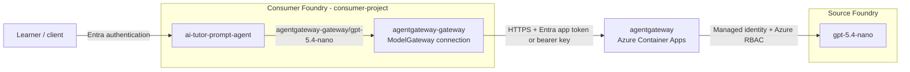
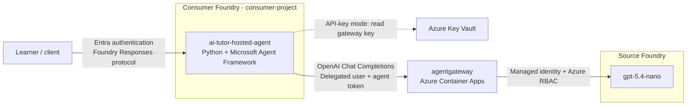

# agentgateway on Azure Container Apps with Microsoft Foundry

An azd + Bicep demo integrating **Microsoft Foundry and agentgateway in both
directions**: Foundry agents access models through agentgateway, which uses
managed identity to call a model hosted in Foundry.

Two independent AI tutors demonstrate the agent-side workflows:

- **Prompt agent:** Foundry sends inference requests through a ModelGateway
  connection to agentgateway.
- **Hosted agent:** Python code using Microsoft Agent Framework runs in Foundry
  and calls agentgateway's OpenAI-compatible API directly.

Both target `gpt-5.4-nano` in a separate **source Foundry account**. The
**consumer Foundry account** hosts the tutors without local model capacity.
Neither tutor invokes the other or bypasses the gateway.

> **Status:** deployed and smoke-tested in UK South with both independent tutors.
> Trace ingestion/correlation, credential rotation, and identity refresh still
> require end-to-end validation.

## Architecture

### Prompt agent: Foundry-managed gateway integration

The tutor selects `agentgateway-gateway/gpt-5.4-nano`. Foundry resolves the
connection and authenticates with an Entra application token (when enabled below)
or the default stored bearer key. The gateway
authenticates to the source model using managed identity and Azure RBAC.



### Hosted agent: direct OpenAI-compatible integration

Clients invoke the hosted tutor through Foundry's Responses protocol. Its Python
runtime calls agentgateway Chat Completions with the alias `gpt-5.4-nano`,
without using a ModelGateway connection. Entra mode supports user-via-agent
delegation; explicit app-only and legacy API-key modes remain available.
Responses-only `include` projections from clients such as the Foundry playground
are logged and ignored rather than forwarded to Chat Completions.



Both paths use the same gateway deployment, whose identity also resolves its
inference key from Key Vault. Both Foundry projects, the gateway, and hosted
tutor target shared Application Insights; resource diagnostics target its Log Analytics workspace.
See [Shared monitoring](#shared-monitoring) for current coverage.

## Requirements

### Tooling and capacity

- Azure CLI 2.73+, Azure Developer CLI 1.35+, and Bicep 0.36.1+ (`az bicep install`).
- Foundry agents azd extension 1.0.0-beta.18+
  (`azd extension install azure.ai.agents`).
- Bash, OpenSSL, and Node.js 20+ for deployment hooks and tests.
- Python 3.13 for local hosted-agent development; remote builds do not require it.
- Subscription quota for `gpt-5.4-nano` using the `GlobalStandard` SKU.

### Permissions

- **Azure provisioning:** permission to provision resources and assign roles:
  Owner, or Contributor
  plus an appropriate Azure RBAC administrator role.
- **Optional Entra authentication:** permission to create and manage application
  registrations, service principals, and application credentials, such as
  Application Administrator, Cloud Application Administrator, or equivalent
  permissions.
- **Optional hosted user delegation:** the trusted backend needs Foundry
  invocation access and the
  `Microsoft.CognitiveServices/accounts/AIServices/agents/endpoints/UserIdentityImpersonation/action`
  data action to represent the user.

Entra directory roles do not replace Azure RBAC permissions. Contributor alone
cannot create role assignments. The deployment scripts assume a signed-in human
account; CI service-principal deployment is not configured.

## Deploy

| Region | Location |
| --- | --- |
| **East US (default)** | `eastus` |
| UK South | `uksouth` |
| Sweden Central | `swedencentral` |

The deployment and both inference paths have been validated in UK South.
Check regional availability and quota before deploying elsewhere.

```bash
az login
azd auth login

# Use uksouth or swedencentral instead if needed.
azd env new agentgateway-demo --location eastus --subscription <subscription-id>
AGENTGATEWAY_API_KEY="sk-$(openssl rand -hex 32)" azd up
```

`azd up` provisions infrastructure and deploys both tutors. Lifecycle hooks
deploy the prompt agent; native azd code deployment remotely builds the hosted
agent, then a Bicep hook grants its identity access. Deployment requires neither
local Docker nor a project-owned container registry.

Configuration:

- [main.parameters.json](infra/main.parameters.json) supplies `CostControl=Ignore`
  and `SecurityControl=Ignore` demo tags. Taggable resources receive these plus
  `azd-env-name`. Use these values only where authorized; tags alone do not
  guarantee a governance-policy exemption.
- [main.bicep](infra/main.bicep) coordinates resource-group-scoped
  [modules](infra/modules/). The allowed regions are listed above; use a new
  environment when changing regions after provisioning.
- The source model defaults to version `2026-03-17`, SKU `GlobalStandard`,
  and capacity `10` (10,000 tokens/minute). Use
  `azd env set MODEL_CAPACITY <capacity>` before provisioning to adjust it.
  Check model availability and quota in the target subscription.
- **GlobalStandard does not guarantee inference residency in the chosen region.**
- [config.yaml](agentgateway/config.yaml) defines strict incoming API-key
  authentication and the Azure model route. Runtime variables are
  `AGENTGATEWAY_API_KEY`, `AZURE_CLIENT_ID` (the gateway identity's client ID),
  and `SOURCE_AZURE_OPENAI_RESOURCE_NAME` (the source account name, not a URL).
  Provisioning wires these into Container Apps. Entra-enabled deployments also
  load [entra.yaml](agentgateway/entra.yaml) for the identity-protected path.

## The two tutors

| Agent | Implementation | Model selection | Deploy/update |
| --- | --- | --- | --- |
| `ai-tutor-prompt-agent` | Foundry-managed prompt | `agentgateway-gateway/gpt-5.4-nano` through the ModelGateway connection | `azd hooks run postprovision` |
| `ai-tutor-hosted-agent` | Python + Microsoft Agent Framework | `gpt-5.4-nano` directly against agentgateway `/v1` | `azd deploy ai-tutor-hosted-agent` |

Each tutor offers explanations, hints, worked examples, and practice questions.
They are independent agents in `consumer-project`, without external tools or
persistent cross-session memory. Deploying one does not replace the other.

### Prompt tutor

Edit [agent.json](agents/ai-tutor-prompt-agent/agent.json), then apply it:

```bash
azd hooks run postprovision
```

The definition uses the standard flat fields: `name`, `description`, `kind`,
`model`, and `instructions`. Its model is
`"agentgateway-gateway/gpt-5.4-nano"`. Changing this selects a model rather than
provisioning one; the alias must already exist in agentgateway and be exposed
by the Foundry connection.

The [deployment hook](scripts/deploy-prompt-agent.mjs) authenticates through
Azure CLI and uses `CONSUMER_FOUNDRY_PROJECT_ENDPOINT`. It preserves the model
in the agent definition instead of replacing it with `CONSUMER_MODEL_REFERENCE`,
maps the flat fields into the REST API's `definition` object, and calls the
Foundry API with `api-version=v1`. It verifies persistence and fails explicitly
on errors. Unchanged definitions reuse the latest version; changes create one.

[azure.yaml](azure.yaml) runs this hook after provisioning and deployment.
The repeated calls during `azd up` are idempotent and do not read the gateway key.

### Hosted tutor

[main.py](agents/ai-tutor-hosted-agent/main.py) combines Agent Framework's
`OpenAIChatCompletionClient` with Foundry's `ResponsesHostServer`. Incoming
Responses requests become Chat Completions calls to agentgateway, not requests
to the prompt tutor.

Update instructions or the model alias in
[agent.json](agents/ai-tutor-hosted-agent/agent.json), then run:

```bash
azd deploy ai-tutor-hosted-agent
```

The alias is `gpt-5.4-nano`, without a connection prefix. The runtime uses
`/delegated/v1` for user delegation, `/entra/v1` for app-only Entra, or `/v1`
for legacy API keys; direct gateway calls do not
use Foundry's connection-qualified model syntax.
Provisioning exports `FOUNDRY_PROJECT_ENDPOINT` for native azd deployment,
alongside the `AZURE_AI_PROJECT_ENDPOINT` alias.

The hosted identity becomes available after deployment. A service-level
`postdeploy` hook retrieves it and applies
[hosted-agent.bicep](infra/modules/hosted-agent.bicep), granting **Key Vault
Secrets User** on the gateway secret and **Monitoring Metrics Publisher** on
Application Insights. The runtime reads the secret lazily for model requests;
neither the code package nor the hosted environment contains the key.
Native azd handles packaging, remote builds, versions, and publication.

### Hosted-agent Entra authentication

To enable Entra authentication after initial provisioning, deploy the gateway
API registration:

```bash
node scripts/configure-gateway-entra.mjs
azd env set HOSTED_GATEWAY_AUTH_MODE entra_delegated
```

[entra.bicep](infra/entra.bicep) owns the application and service principal,
API scope, claims, and CLI preauthorization using the pinned Microsoft Graph
extension. The helper deploys this separate template and saves nonsecret outputs
in azd. For existing registrations, it assigns the immutable `uniqueName` once
and preserves their application, service principal, and scope IDs. Ordinary
`azd provision` does not require permission to manage Entra applications.

Reprovision using the existing-key command in [Permissions and secrets](#permissions-and-secrets),
then run `azd deploy ai-tutor-hosted-agent`. The hosted tutor uses `/delegated/v1`;
the prompt tutor keeps its API-key connection unless migrated as described below.
The deployment hook authorizes the actual hosted identity at agentgateway and
removes its gateway-secret read permission.
The provisioning hook restarts the gateway to refresh its secret-mounted config.

The gateway validates signature, tenant, audience, the allowed human (`oid`),
the hosted Agent ID actor (`azp`), and `gateway.invoke`. App-only tokens cannot
use this route. Source-model access still uses the gateway's managed identity.

Your trusted application backend must perform the
[Agent ID OBO exchange](https://learn.microsoft.com/en-us/entra/agent-id/agent-on-behalf-of-oauth-flow)
and supply a **gateway-audience delegated token**, not the original user token.
Configure the agent blueprint's user-facing API, delegated gateway permission,
consent and permission inheritance; use a federated credential or certificate
for the backend. Foundry does not perform OBO automatically, and this repository
does not deploy a sign-in/OBO backend.

Invoke the hosted Responses endpoint using
[Foundry's delegated-token forwarding](https://learn.microsoft.com/en-us/azure/foundry/agents/how-to/use-on-behalf-of-flow):

```http
Authorization: Bearer <backend Foundry access token>
x-client-agentgateway-access-token: <user-via-agent gateway access token>
x-ms-user-identity: <authenticated human object ID>

{"input":"Explain fractions.","store":false,"background":false,"stream":false}
```

The runtime keeps the forwarded token request-scoped, strips it before adapter
metadata processing, and rejects stored
or background requests. Streaming is supported. Missing/denied tokens never
trigger app-only or API-key retries.

For an explicit autonomous fallback, set `HOSTED_GATEWAY_AUTH_MODE=entra`,
reprovision and redeploy. That mode uses `DefaultAzureCredential` and `/entra/v1`;
it does not represent a human. The default without a gateway Entra registration
remains legacy API-key authentication.

### Prompt-agent Entra authentication

With gateway Entra authentication configured, migrate the ModelGateway connection:

```bash
node scripts/configure-gateway-entra.mjs --include-prompt
node scripts/configure-prompt-gateway-entra.mjs
vault="$(azd env get-value AZURE_KEY_VAULT_NAME)"
AGENTGATEWAY_API_KEY="$(az keyvault secret show --vault-name "$vault" \
  --name agentgateway-api-key --query value -o tsv)" \
PROMPT_GATEWAY_CLIENT_SECRET="$(az keyvault secret show --vault-name "$vault" \
  --name agentgateway-prompt-client-secret --query value -o tsv)" azd provision
```

Foundry uses OAuth2 client credentials to obtain a token for `/entra/v1`.
agentgateway authorizes the dedicated application's service principal; this is
**not the prompt agent's Agent ID or the invoking user's identity**. ModelGateway
[documents OAuth2 client credentials](https://learn.microsoft.com/en-us/azure/foundry/agents/how-to/ai-gateway),
not user-via-agent authentication, for model inference.
The prompt definition and source-model authentication remain unchanged.

Graph Bicep also creates the prompt application and service principal; it does
not manage passwords. The credential script only creates/reuses a one-year
client secret in Key Vault. Provisioning copies the process-supplied secret into
Foundry's secure connection storage without rewriting its Key Vault metadata.
Supply both secrets as above for subsequent provisioning. Rotate the Entra
credential before expiry and update both stored copies; expired or mismatched
credentials are rejected rather than silently replaced.
Direct managed-identity authentication was tested and rejected by Foundry's
`ModelGateway` API, which currently accepts only `ApiKey` or `OAuth2`.

### Local hosted-agent development

For local development, create the virtual environment and start the tutor from
the project root:

```bash
python3.13 -m venv agents/ai-tutor-hosted-agent/.venv
agents/ai-tutor-hosted-agent/.venv/bin/python -m pip install \
  -r agents/ai-tutor-hosted-agent/requirements.txt
azd ai agent run ai-tutor-hosted-agent --no-client
```

The selected azd environment supplies provisioned endpoints and vault settings;
local access uses your signed-in Azure identity. With Foundry Toolkit and Python
Debugger installed, press **F5** in VS Code to launch the debugger and Agent
Inspector. Ports 5679 and 8088 must be available.

## Permissions and secrets

The deploying human user receives explicit Azure RBAC assignments:

| Role | Scope |
| --- | --- |
| Contributor | Sample resource group |
| Key Vault Secrets Officer | Sample vault |
| Foundry User / Azure AI User | Both Foundry accounts |
| Log Analytics Reader | Application Insights and its workspace |
| Privileged Monitoring Data Reader | Application Insights and its workspace |

The gateway identity has **Cognitive Services OpenAI User** on the source account
and **Key Vault Secrets User** on the individual gateway secret. Both Foundry
accounts disable local API-key authentication.

`AGENTGATEWAY_API_KEY` is an inference bearer credential, not an admin key.
Bicep stores it as `agentgateway-api-key` in an RBAC-protected, purge-protected
vault. Container Apps uses a versionless Key Vault reference with managed
identity. In API-key mode, the ModelGateway connection holds a separate secure copy:
**rotation must update both copies and refresh the running gateway credential.**

Reuse the existing key for infrastructure changes:

```bash
vault="$(azd env get-value AZURE_KEY_VAULT_NAME)"
AGENTGATEWAY_API_KEY="$(az keyvault secret show --vault-name "$vault" \
  --name agentgateway-api-key --query value -o tsv)" azd provision
```

Do not commit secrets or share `.azure/`. Avoid `azd env set` for the key because
it persists a local copy; the examples supply it only to the command's process.
Only inference port 4000 is exposed through HTTPS ingress; admin, metrics,
readiness, and collector endpoints are not public.

## Shared monitoring

[monitoring.bicep](infra/modules/monitoring.bicep) provisions a shared
workspace-backed Application Insights component and Log Analytics workspace.
Local-auth ingestion is disabled.

Both Foundry projects connect with **Project Managed Identity**; each project's
system-assigned identity receives **Monitoring Metrics Publisher** on that
component only. The connections are created after their role assignments.
Project-managed trace ingestion is a Foundry preview. The connection uses API
`2026-09-01`; its `ProjectManagedIdentity` authentication is ahead of the published
Bicep types, so the modules narrowly suppress the missing-schema warning.

agentgateway sends OpenTelemetry spans to a loopback-only collector sidecar.
The collector authenticates with the gateway identity and **Monitoring Metrics
Publisher**, allowing Entra-only ingestion. The Application Insights connection
string identifies the destination; it is not an authentication credential.
Gateway traces omit prompt/response content in the tested configuration.

The hosted tutor exports Agent Framework/OpenTelemetry traces to the same
component using its own identity, with message-content capture disabled.
The prompt tutor uses the consumer project's managed tracing connection.

Supported diagnostics from Foundry accounts/projects, Key Vault, Container Apps,
and its environment target the shared workspace. Resource diagnostics are
separate from Application Insights traces; vault audit logs cover secret access.
The deployer's monitoring roles can expose sensitive GenAI data.

azd outputs include `APPLICATIONINSIGHTS_NAME`,
`APPLICATIONINSIGHTS_RESOURCE_ID`, `APPLICATIONINSIGHTS_CONNECTION_STRING`, and
`AZURE_LOG_ANALYTICS_WORKSPACE_ID`. Inspect **Application Insights > Logs** for
traces, **Foundry > Agents > Traces** for agent traces, and the shared workspace
for resource logs. Azure ingestion and
cross-component correlation remain unverified; ingestion can incur charges.

## Validate and operate

Local checks do not provision Azure resources or call external models.
Infrastructure tests require Azure CLI/Bicep. Gateway tests run the pinned
Linux amd64 image with mock identity, model, and OTLP endpoints; they require
Podman on Linux with host networking. Set `CONTAINER_RUNTIME=docker` for Docker
on Linux.

```bash
# Compile Bicep and run local contract/runtime tests.
node --test tests/infra.test.mjs tests/agent.test.mjs \
  tests/deployment.test.mjs tests/entra.test.mjs tests/gateway.test.mjs
agents/ai-tutor-hosted-agent/.venv/bin/python -m unittest discover \
  -s agents/ai-tutor-hosted-agent -p 'test_*.py'

# Preview infrastructure changes; supply the existing key as shown above.
azd provision --preview

# Remove the sample when finished.
azd down
```

After deployment, inspect the consumer project's connection under **Manage >
Resource details > Admin-connected models** and test each tutor independently.
Verify real identity issuance/refresh, RBAC, rotation, and telemetry ingestion.
Inference, hosted-agent compute, and monitoring incur usage charges.

This is a public-network demonstration, not a production landing zone:

- agentgateway is pinned to `v1.6.0` by Linux amd64 digest. It runs one always-on
  replica with 1 vCPU and 2 GiB, without high availability or a persistent spend
  database.
- The OpenTelemetry collector is pinned to `0.162.0` and adds 0.25 vCPU/0.5 GiB.
- The optional Entra API registration is outside the resource group. Delete it
  separately with `az ad app delete --id <AGENTGATEWAY_ENTRA_CLIENT_ID>` when
  removing an Entra-enabled deployment. If prompt OAuth is enabled, also delete
  its dedicated application with `az ad app delete --id <PROMPT_GATEWAY_CLIENT_ID>`.
- Log Analytics retention is 30 days. Avoid sensitive prompt logging.
- Hosted-agent dependencies include preview components; response storage is
  in-process, not durable background-job or cross-session storage.
- RBAC propagation can delay initial requests. Regional model quota does not
  guarantee Container Apps capacity.
- Versionless Key Vault references are refreshed asynchronously; configuration
  or credential changes may require restarting the active revision.
- Vault purge protection and Foundry soft deletion can reserve names after
  cleanup. Use a fresh environment for clean retries; do not purge automatically.

## Current azd Foundry extension limitation

Foundry gateway-connected prompt agents require the model format
**`<connection-name>/<model-name>`**, here
`agentgateway-gateway/gpt-5.4-nano`.

Native prompt deployment has encountered azd extension validation that rejects
the `/` separator. This sample therefore deploys the prompt tutor through
lifecycle hooks and the Foundry API, preserving the required model reference.
The current extension's validation behavior has not been re-tested here.

This workaround concerns native prompt-service validation, not agentgateway's
inference API. The hosted tutor still uses native azd deployment because its
Python runtime selects the unqualified gateway alias.

See [Foundry gateway-connected models](https://learn.microsoft.com/azure/foundry/agents/how-to/ai-gateway#create-a-prompt-agent-with-the-model-connection)
and [azd lifecycle hooks](https://learn.microsoft.com/azure/developer/azure-developer-cli/azd-extensibility).
