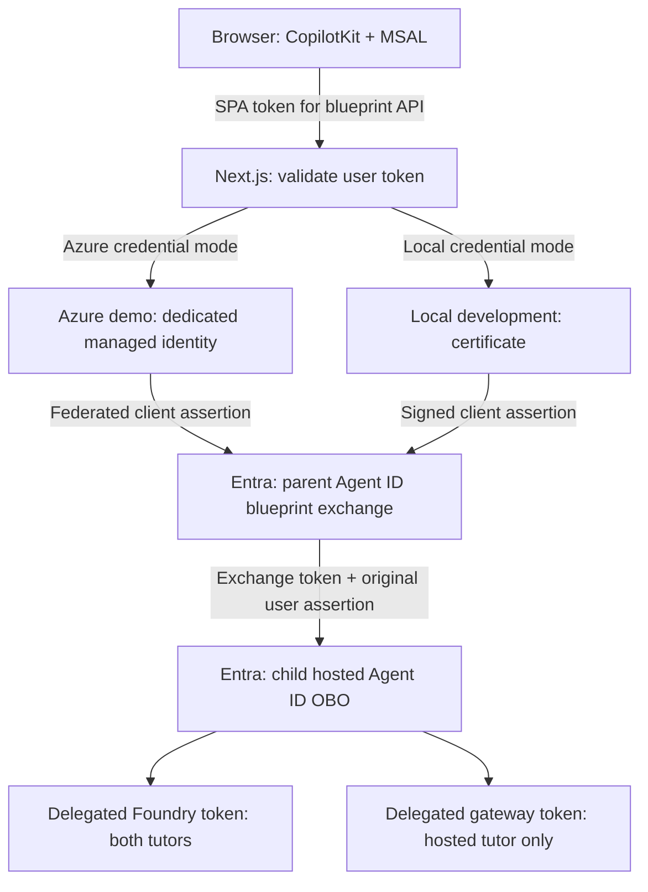
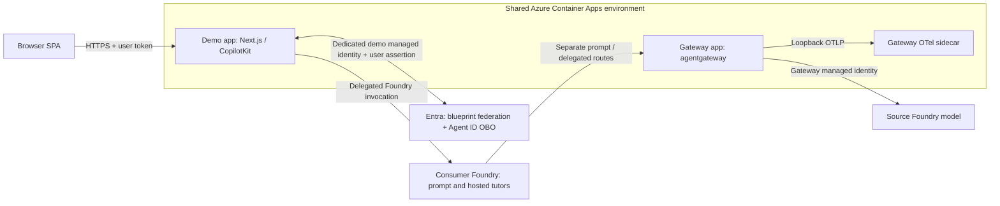
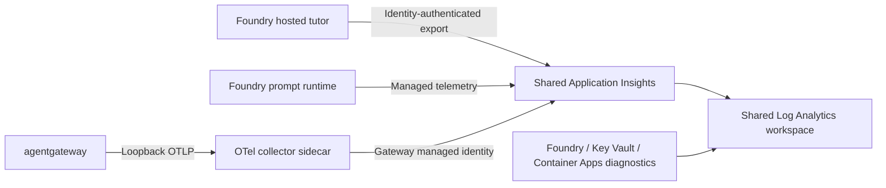

# Microsoft Foundry agents with agentgateway

An azd + Bicep demonstration of **Microsoft Foundry and agentgateway integration
in both directions**: Foundry agents call models through agentgateway, and the
gateway uses managed identity to call a model hosted in Foundry.

Two independent AI tutors demonstrate different integration capabilities:

| Tutor | Foundry integration | Identity at agentgateway |
| --- | --- | --- |
| Prompt agent | Managed ModelGateway connection using OAuth2 client credentials | Dedicated prompt-client application |
| Hosted agent | Python + Microsoft Agent Framework, exposed through Foundry Responses | Human user acting through the hosted Entra Agent ID |

Both target `gpt-5.4-nano` in a separate **source Foundry account**. The
**consumer Foundry account** hosts both tutors without local model capacity.
Neither tutor invokes the other or bypasses the gateway.

**Inference is Entra-only.** There is no shared gateway API key, API-key
connection, or hosted app-only authentication mode. The prompt OAuth client
secret remains necessary for the managed ModelGateway connection; it is not a
shared inference key.

**Live validation completed on 18 October 2026:** both tutors work through the
CopilotKit demo, including Azure-hosted managed-identity federation, delegated
Agent ID OBO, token renewal, and streaming Stop/recovery. The legacy shared key
and its secret-scoped reader assignment have been removed from the tested
environment. See [validation status](#validation-status) for evidence and limits.

## Start here

| Goal | Section |
| --- | --- |
| Understand the identities and request paths | [Architecture](#architecture) |
| Create a new environment | [Deploy](#deploy) |
| Run the demo on your machine | [Local CopilotKit demo](#local-copilotkit-demo) |
| Host the demo with managed identity | [Azure-hosted demo](#azure-hosted-copilotkit-demo-managed-identity-federation) |
| Upgrade an older API-key deployment | [Migration](#existing-environment-migration) |
| Understand what is verified and what remains | [Validation status](#validation-status) |

## Architecture

### Prompt tutor: Foundry-managed model access

```mermaid
flowchart LR
    User["Learner + browser SPA"]
    Backend["Next.js demo backend"]
    Tutor["Foundry prompt tutor"]
    Connection["ModelGateway connection"]
    Gateway["agentgateway on Container Apps"]
    Model["Source Foundry model"]
    User -->|"User token for blueprint API"| Backend
    Backend -->|"Agent ID OBO: delegated Foundry token"| Tutor
    Tutor -->|"agentgateway-gateway/gpt-5.4-nano"| Connection
    Connection -->|"OAuth2 application token"| Gateway
    Gateway -->|"Managed identity + Azure RBAC"| Model
```



Foundry obtains an application token for the gateway API using the dedicated
prompt client's credentials. The `/entra/v1/chat/completions` route requires
that application's service principal (`oid`), client ID (`azp`), and app-only
token type. It rejects delegated users and the hosted agent's app-only identity.
The prompt caller's human identity is **not** propagated to agentgateway.
The demo authenticates the user and performs Agent ID OBO to invoke Foundry,
but the managed connection independently obtains the prompt application's token.

### Hosted tutor: user-via-agent model access

```mermaid
flowchart LR
    User["Learner + browser SPA"]
    Backend["Next.js demo backend"]
    Hosted["Foundry hosted tutor"]
    Gateway["agentgateway on Container Apps"]
    Model["Source Foundry model"]
    User -->|"User token for blueprint API"| Backend
    Backend -->|"Delegated Foundry bearer + forwarded gateway token"| Hosted
    Hosted -->|"User-via-agent gateway token"| Gateway
    Gateway -->|"Managed identity + Azure RBAC"| Model
```



The `/delegated/v1/chat/completions` route validates the signature, tenant,
audience, authorized human (`oid`), hosted Agent ID actor (`azp`), and
`gateway.invoke` scope. App-only tokens cannot use it. The sample authorizes the
deploying human; adapt that explicit policy for your application.

The gateway's managed identity, not the incoming token, authenticates upstream
to the source model. Both Foundry accounts disable local API-key authentication.

### Demo authentication: same OBO flow, different backend credentials



| Boundary | Identity / credential | Purpose |
| --- | --- | --- |
| Browser → demo | Signed-in human; SPA token for the blueprint API | Authenticate the configured demo user |
| Azure demo → blueprint | Dedicated demo managed identity, trusted by a blueprint federated credential | Bootstrap the exchange without a certificate or client secret |
| Local demo → blueprint | Local RSA certificate assertion | Development-only alternative; not deployed to Azure |
| Demo → Foundry | Human user via hosted Agent ID | Invoke either named tutor endpoint |
| Hosted tutor → gateway | Human `oid`, hosted Agent ID `azp`, `gateway.invoke` | Use the delegated gateway route |
| Prompt connection → gateway | Dedicated prompt application | Use the app-only OAuth2 gateway route |
| Gateway → source model | Separate gateway managed identity | Authenticate upstream with Azure RBAC |

The **demo identity**, **hosted Agent ID**, **prompt application**, and **gateway
identity** are distinct. Managed identity replaces the demo backend's blueprint
credential; it does not replace the human or turn OBO into app-only inference.

## Requirements

### Tooling and capacity

- Azure CLI 2.73+, Azure Developer CLI 1.35+, and Bicep 0.36.1+.
- Foundry agents azd extension 1.0.0-beta.18+.
- Bash and Node.js 20+ for deployment hooks and tests.
- Node.js 22+ and npm for the optional local CopilotKit demo.
- Python 3.13 for local hosted development; remote builds do not require it.
- Subscription quota for `gpt-5.4-nano`, version `2026-03-17`, `GlobalStandard`.
- East US (`eastus`, default), UK South (`uksouth`), or Sweden Central
  (`swedencentral`), subject to service availability and quota.

### Permissions and delegated caller

- **Azure provisioning:** permission to provision resources and assign roles:
  Owner, or Contributor plus an appropriate Azure RBAC administrator role.
- **Entra provisioning:** permission to manage applications, service principals,
  and credentials, such as Application Administrator, Cloud Application
  Administrator, or equivalent permissions.
- **Hosted caller:** a trusted backend performing the
  [Agent ID OBO exchange](https://learn.microsoft.com/en-us/entra/agent-id/agent-on-behalf-of-oauth-flow).
  Configure the hosted blueprint's user-facing API, delegated gateway permission,
  consent, and permission inheritance. Use a federated credential or certificate
  for that backend. The optional demo setup below configures these explicitly.
- The demo calls Foundry with a **delegated user-via-agent Foundry token**; the
  authorized human already receives Foundry User during provisioning. This is
  separate from the gateway-scoped delegated token forwarded to the hosted tutor.
  It deliberately does not fall back to workload authentication.
- If you instead implement Foundry's separate workload-authenticated invocation
  pattern with `x-ms-user-identity`, that workload needs invocation access and the
  `Microsoft.CognitiveServices/accounts/AIServices/agents/endpoints/UserIdentityImpersonation/action`
  data action when representing the user. The demo does not select that pattern.

Entra directory permissions do not replace Azure RBAC. Contributor alone cannot
create role assignments. Scripts assume a signed-in human; CI service-principal
deployment is not configured.

## Deploy

Fresh deployments have an explicit bootstrap stage: the vault must exist before
the prompt OAuth credential can be stored. No temporary API-key deployment is
needed.

### 1. Bootstrap shared resources

```bash
az login
azd auth login
azd extension install azure.ai.agents
azd env new agentgateway-demo --location uksouth --subscription <subscription-id>
azd env set AZURE_PRINCIPAL_ID "$(az ad signed-in-user show --query id -o tsv)"

environment="$(azd env get-value AZURE_ENV_NAME)"
location="$(azd env get-value AZURE_LOCATION)"
principal="$(azd env get-value AZURE_PRINCIPAL_ID)"

az deployment sub create --name "$environment-bootstrap" --location "$location" \
  --template-file infra/bootstrap.bicep \
  --parameters environmentName="$environment" location="$location" principalId="$principal" \
  'tags={"CostControl":"Ignore","SecurityControl":"Ignore"}' --output none

azd env set AZURE_RESOURCE_GROUP "$(az deployment sub show \
  --name "$environment-bootstrap" --query properties.outputs.resourceGroupName.value -o tsv)"
azd env set AZURE_KEY_VAULT_NAME "$(az deployment sub show \
  --name "$environment-bootstrap" --query properties.outputs.keyVaultName.value -o tsv)"
```

[bootstrap.bicep](infra/bootstrap.bicep) reuses the same names and modules as the
full deployment for the resource group, gateway identity, monitoring, vault,
and deployer access. It does not create an inference endpoint.
Allow RBAC propagation before storing credentials.

The demo tags in [main.parameters.json](infra/main.parameters.json) are not a
guarantee of governance-policy exemption; use them only where authorized.

### 2. Configure both Entra registrations and the prompt credential

```bash
node scripts/configure-gateway-entra.mjs
node scripts/configure-prompt-gateway-entra.mjs
```

[entra.bicep](infra/entra.bicep) uses a pinned Microsoft Graph extension to
provision both applications/service principals, the gateway scope, token claims,
and CLI preauthorization. Existing registrations retain their IDs, scopes, and
API settings; the adoption helper assigns an immutable `uniqueName` once.
Directory provisioning is separate from ordinary `azd provision`.

Graph Bicep does not manage passwords. The
[credential helper](scripts/configure-prompt-gateway-entra.mjs) creates/reuses a
one-year prompt-client secret in Key Vault. Disabled, expired, or mismatched
credentials require explicit rotation rather than silent replacement.

### 3. Provision and deploy

```bash
vault="$(azd env get-value AZURE_KEY_VAULT_NAME)"
PROMPT_GATEWAY_CLIENT_SECRET="$(az keyvault secret show --vault-name "$vault" \
  --name agentgateway-prompt-client-secret --query value -o tsv)" azd up
```

Supply the credential through the command's process environment, not
`azd env set`. Foundry keeps its own secure connection copy. Rotate the Entra
credential before expiry and update both copies.

The [main template](infra/main.bicep) requires both applications and the prompt
credential. It provisions the source model, consumer projects, identity-only
gateway, and OAuth2 connection. The source model defaults to capacity `10`
(10,000 tokens/minute); set `MODEL_CAPACITY` before provisioning to adjust it.
**GlobalStandard does not guarantee inference residency in the chosen region.**

Native azd code deployment remotely builds the hosted agent without local
Docker or a project-owned registry. Its postdeploy hook grants the hosted
identity telemetry publishing and binds that identity as the gateway's delegated
actor. Until the actor exists, delegated inference is denied.
Project hooks deploy the prompt tutor idempotently.

Configure and test the trusted OBO caller after the hosted Agent ID exists.
There is no fallback to app-only tokens or shared keys.

## Use and update the tutors

### Prompt tutor

The prompt model is `agentgateway-gateway/gpt-5.4-nano`. Edit
[agent.json](agents/ai-tutor-prompt-agent/agent.json), then run:

```bash
azd hooks run postdeploy
```

The [deployment helper](scripts/deploy-prompt-agent.mjs) preserves the
connection-qualified model reference and verifies the persisted version.
Unchanged definitions reuse the latest version.

The prompt connection uses OAuth2 client credentials, **not** the prompt Agent
ID or invoking human. Direct managed-identity authentication was tested and
rejected by Foundry's custom ModelGateway API, which accepts `ApiKey` or `OAuth2`;
this sample uses only OAuth2.

### Hosted tutor

[main.py](agents/ai-tutor-hosted-agent/main.py) adapts Foundry Responses requests
to gateway Chat Completions using the unqualified alias `gpt-5.4-nano`.
Responses-only `include` projections are logged and ignored instead of passed
to Chat Completions. Edit its instructions in
[agent.json](agents/ai-tutor-hosted-agent/agent.json), then run:

```bash
azd deploy ai-tutor-hosted-agent
```

Invoke through the trusted backend using
[Foundry's delegated-token forwarding](https://learn.microsoft.com/en-us/azure/foundry/agents/how-to/use-on-behalf-of-flow):

```http
Authorization: Bearer <delegated user-via-agent Foundry access token>
x-client-agentgateway-access-token: <user-via-agent gateway access token>
Content-Type: application/json

{"input":"Explain fractions.","store":false,"background":false,"stream":false}
```

The forwarded token must target the gateway API, not Foundry or Microsoft Graph.
The runtime isolates it per request, strips the forwarding header before adapter
metadata processing, and rejects stored/background requests. Streaming is
supported. Missing or denied credentials never cause a different identity to be
used. `DefaultAzureCredential` is used only for telemetry, not model inference.
The OpenAI SDK parameter named `api_key` carries the delegated bearer token; it
does not enable shared-key authentication.

The demo uses the
[named agent Responses endpoints](https://learn.microsoft.com/en-us/azure/foundry/agents/quickstarts/prompt-agent)
for both tutors. It does not send `x-ms-user-identity`: that header belongs to the
separate workload-impersonation pattern described in Foundry's OBO documentation.
Direct delegated Foundry invocation plus gateway-token forwarding is the
combination verified by the live checks in the tested environment.

### Local development

```bash
python3.13 -m venv agents/ai-tutor-hosted-agent/.venv
agents/ai-tutor-hosted-agent/.venv/bin/python -m pip install \
  -r agents/ai-tutor-hosted-agent/requirements.txt
azd ai agent run ai-tutor-hosted-agent --no-client
```

The selected environment supplies the delegated gateway endpoint. F5 in VS Code
starts the debugger and Agent Inspector with ports 5679/8088. The server can
start without a delegated token, but **every inference request must supply one**.
A plain playground/Inspector/azd chat request without the forwarding header is
rejected; use a caller capable of sending the required headers and stateless
request body.

## Local CopilotKit demo

[apps/demo](apps/demo) is one Next.js application: React/CopilotKit and MSAL in the
browser, plus JWT validation, Agent ID OBO, and a streaming
Responses-to-AG-UI adapter on the server. There is no Python/FastAPI middle tier
and no local model or extra agent. The hosted tutor still runs Python/MAF in
Foundry. Both tutors keep their existing definitions and gateway policies.

| Run location | Backend blueprint credential | Hosting |
| --- | --- | --- |
| Local development | Certificate; explicit `DEMO_AUTH_MODE=certificate` | Loopback-only Next.js server |
| Azure | Federated managed identity; explicit `DEMO_AUTH_MODE=managed-identity` | Separate demo Container App |

Both use the [same two-stage OBO flow](#demo-authentication-same-obo-flow-different-backend-credentials).

The browser token targets the hosted agent's **parent blueprint API**, not the
gateway or Foundry. The backend checks its signature, issuer, tenant, audience,
SPA client, delegated scope, expiration, and authorized human before any OBO
exchange. Only that human is allowed; signing in as another tenant user is not
enough. Agent IDs, endpoints, scope names, and credentials come from server
configuration, never browser-provided overrides.

### 1. Prepare local dependencies and a certificate

Use Node.js 22 or later. From the repository root:

```bash
npm ci --prefix apps/demo
mkdir -p .certificates
chmod 700 .certificates
```

Generate a dedicated local certificate only if these files do not already exist.
Do not overwrite an existing credential just to restart the app:

```bash
(umask 077; openssl req -x509 -newkey rsa:2048 -nodes \
  -keyout .certificates/demo.key -out .certificates/demo.pem \
  -days 365 -subj "/CN=foundry-agentgateway-local-demo")
chmod 600 .certificates/demo.key
```

These files are ignored by Git. The public certificate is uploaded to the parent
blueprint; the private key stays on this machine. Neither its contents nor a
client secret are written to azd environment state. For production, prefer
managed-identity federation and a hosted, access-controlled backend rather than
copying the local private key to a service.

### 2. Preview, then explicitly configure Entra

First deploy the hosted tutor so `HOSTED_AGENT_PRINCIPAL_ID` identifies the actual
hosted Agent ID. Sign in to Azure CLI in the same tenant as the selected azd
environment. With an existing deployment, prepare the caller before switching
gateway authentication as described under migration.

```bash
node scripts/configure-demo-entra.mjs
```

The [setup helper](scripts/configure-demo-entra.mjs) defaults to **read-only
preview**. It discovers and checks the hosted identity's real parent blueprint,
then describes the API scope, public certificate, two downstream permissions,
user-specific grants, and dedicated SPA registration. Review the plan before:

```bash
node scripts/configure-demo-entra.mjs --apply
node scripts/configure-demo-entra.mjs --write-env
```

`--apply` performs directory changes and saves only the nonsecret SPA/blueprint
IDs and origin in azd. [demo-entra.bicep](infra/demo-entra.bicep) uses the existing
pinned Graph extension for the SPA, service principal, and SPA-to-blueprint
consent. Narrow Graph REST operations adopt the existing Foundry-owned blueprint,
preserve unrelated API settings, credentials, scopes, and grants, and configure
its Agent ID inheritance, which this pinned Bicep extension does not model.
The helper rereads Graph and fails if blueprint changes did not persist.

The downstream permissions are `https://ai.azure.com` / `user_impersonation` and
the gateway API / `gateway.invoke`. Consent grants are for `AZURE_PRINCIPAL_ID`,
not tenant-wide. **Blueprint inheritance applies to its child identities**, not
just this UI: review other children before applying. Existing broad inheritance
or grants are preserved, not silently narrowed. The helper does not grant Azure
RBAC or rotate/delete existing credentials. Agent ID blueprint administration
and delegated-consent permissions can require additional directory roles; an
application-management role alone is not a guarantee.

`--write-env` exports an allowlist to ignored `apps/demo/.env.local` with mode
`0600`. It refuses to overwrite an existing file, validates private-key file
permissions, and never exports the prompt client's secret. Review the existing
file before explicitly removing/re-exporting it. See
[.env.example](apps/demo/.env.example) for the configuration contract.
`DEMO_CERTIFICATE_PATH` and `DEMO_PRIVATE_KEY_PATH` can point to alternative
absolute paths. Set `DEMO_ORIGIN` before preview/apply to use a different origin.

The default origin is **`http://localhost:3000`** and the registered SPA callback
is **`http://localhost:3000/auth/callback`**. MSAL uses a dedicated redirect-bridge
page and **popup sign-in**, allowing access tokens to remain memory-only; allow
the popup. Do not browse `127.0.0.1` while configuring `localhost`, or change the
port without updating the origin/registration.

### 3. Start and compare the tutors

```bash
npm run dev --prefix apps/demo
```

Open `http://localhost:3000` or select **Debug CopilotKit demo** in VS Code.
The server binds to loopback. Sign in as the configured human, choose the hosted
or prompt tutor, and send a message. Chat is text-only, with 1-40 messages per
request, at most 16,000 characters per message and a 128 KiB request limit.
Client-defined tools, system instructions, endpoint overrides, and attachments
are unsupported. The upstream run is foreground, streamed, and `store:false`;
the current page supplies its history. There is no application database or global
downstream token cache. CopilotKit keeps bounded process-local run/event state
for runtime coordination; it is not a durable chat store. Resetting, changing
tutor, signing out, or reloading the page starts a fresh UI conversation; it does
not promise immediate erasure of runtime memory or Azure diagnostic records.

**Stop** aborts the bridge's active Foundry HTTP request. The next request can
continue normally; this was verified live after fixing the adapter's
`abortRun()` implementation. Cancellation does not prove that Foundry or the
source model stops computation or billing.

Sign-in tokens renew silently while the page is open. If interaction is needed,
chat unmounts until sign-in is renewed. The backend remains authoritative even
when the browser has a token. Errors expose safe stage/code/request identifiers,
not assertions, private keys, token endpoint response bodies, or model prompts.
CopilotKit server telemetry is disabled; the existing Azure monitoring remains.

### 4. Test offline, then run explicit live acceptance

```bash
npm test --prefix apps/demo
npm run typecheck --prefix apps/demo
npm run lint --prefix apps/demo
npm run build --prefix apps/demo
cd apps/demo
npx playwright install --with-deps chromium
npm run test:browser
```

Browser tests use mocked Entra and Foundry responses with the real CopilotKit
runtime/adapter, including a real MSAL popup/redirect-bridge round trip, chat,
tutor isolation, reset, sign-out, forced silent renewal, and recovery when Entra
requires interaction. No authentication bypass is exposed by
the application; test doubles are confined to the test runner.
Server tests use signed local JWTs, real certificate assertions, mocked token
endpoints and Responses streams, and the real CopilotKit HTTP runtime. They cover
wrong tenant/user/caller/audience/scope, expiry, credential isolation, malformed
and truncated streams, HTTP-200 failure events, cancellation, and output limits.
The actual CopilotKit Stop endpoint is tested for upstream abort, stale-run
rejection, and a successful subsequent run on the same thread.
The Graph setup tests also verify preview-only behavior, preservation,
user-specific consent, persistence checks, and safe environment export.

Offline success is **not** proof of deployed user OBO. After the explicit
identity setup and identity-only rollout, sign in and select **Run live checks**:

- Verify the signed gateway token's human, hosted actor, audience, tenant, and scope.
- Complete hosted streaming and a stateless follow-up.
- Complete prompt streaming through its existing managed OAuth2 connection.
- Confirm the delegated gateway route denies missing and wrong-audience tokens.
- Confirm the old `/v1/chat/completions` route returns 404.

This makes **three model calls** and can incur Azure charges. It does not mutate
Azure, deploy, create credentials, or remove the legacy key. Results contain only
check names, duration, and request IDs. A failed check is not reported as passed.
Expired tokens, wrong gateway actors/users, and stream failure cases are tested
offline; the live button does not mint extra identities just to reproduce them.
The prompt success check relies on the deployed OAuth2 connection and the
gateway's strict prompt-client policy; use Azure diagnostics for that identity's
audit trail.

Select **Check silent renewal** to bypass MSAL's access-token cache and request a
token from Entra. The UI reports only success and expiry, never token contents.
Then rerun the live checks to verify that the renewed token works through OBO.
If Entra requires interaction, the chat is unmounted, in-flight live checks are
aborted, and **Renew sign-in** is offered. This forced-renewal check does not
prove natural expiry or a multi-hour session; those need a separate soak test.
Browser regression tests simulate successful renewal and interaction-required
recovery; they are not live Entra evidence.

For a caller that already supplies a legitimate SPA-to-blueprint assertion via
a protected file or stdin, an equivalent CLI runner is available:

```bash
cd apps/demo
npm run test:live -- --token-file /absolute/path/to/owner-only-assertion-file
# Or pipe the assertion from a trusted source:
# <trusted-source> | npm run test:live -- --stdin
```

Do not paste tokens into command-line arguments, terminal output, source files,
or shared logs. The UI button needs no manual token extraction and is preferred.
Delete any temporary assertion file after use. The CLI does not sign in as an
application if a user assertion is missing or rejected.

For certificate rotation, generate a new pair at different ignored paths,
preview/apply the new public certificate, update the local paths, and test both
tutors before separately retiring the old certificate. Nothing deletes or
replaces an old credential automatically.

## Azure-hosted CopilotKit demo: managed identity federation

The same Next.js app can run as a **separate Container App in the gateway's
existing ACA environment**, using its own user-assigned managed identity. It
does not reuse the gateway identity or run inside the Foundry hosted tutor.
The managed identity is trusted by a federated identity credential on the
existing hosted Agent ID blueprint.



The Foundry tutors do **not** run in the shared Container Apps environment.
The demo and gateway are separate apps with separate managed identities.

This replaces only the blueprint credential, not delegated user authentication.
The gateway still requires the configured human and hosted Agent ID. There is
no app-only, certificate, or API-key fallback when managed identity fails.
The app uses an explicit `ManagedIdentityCredential` with the dedicated identity's
client ID, not a general developer credential chain.

After completing the existing gateway, hosted tutor, and demo Entra setup:

```bash
# Read-only preview, bound to the selected azd environment:
node scripts/deploy-demo.mjs
# Provision, federate, remotely build, deploy, and check public configuration:
node scripts/deploy-demo.mjs --apply
```

The [deployment helper](scripts/deploy-demo.mjs) uses
[demo-hosting.bicep](infra/demo-hosting.bicep) as a separate resource-group
deployment alongside the main azd infrastructure. It creates a dedicated Basic
ACR registry, dedicated identity, registry-scoped AcrPull assignment, and the
Next.js app. These incur additional Azure charges. It does not redeploy the
gateway or Foundry tutors. Rerun this helper after changing the demo; the root
`azd deploy` still deploys the Foundry hosted tutor, not the web app.

ACR builds the image remotely; no local container daemon or registry password
is needed. The [Docker context allowlist](apps/demo/.dockerignore) excludes local
environment files, certificates, dependencies, and test artifacts. The production
image runs as a non-root user, contains Next.js standalone output, and is deployed
by immutable image digest. The app uses HTTPS ingress, readiness/startup probes,
and scales from zero to one replica. CopilotKit's in-memory runner coordinates
Stop requests within one process; multiple replicas require shared run coordination.
Active runs do not survive a restart or redeployment. Stop aborts the bridge's
Foundry HTTP request, but does not prove that Foundry or the model stops billing.

The helper preserves existing SPA callbacks, including localhost, adds the
hosted HTTPS callback, and preserves existing blueprint keys and unrelated
federated credentials. It refuses to replace an existing demo federation that
trusts a different identity. The federation uses the managed identity's
**principal ID** as subject; runtime selection uses its **client ID**.
Only nonsecret identifiers and `DEMO_HOSTED_ENDPOINT` are saved to azd.
The existing local `DEMO_ORIGIN` and ignored local configuration are not replaced.
No certificate or private-key path is configured in the Azure app.

Open `DEMO_HOSTED_ENDPOINT`, sign in as the configured human, and select
**Run live checks**. This verifies the same delegated flows and gateway denials
as the local demo, now bootstrapped by the Azure managed identity.
Deployment readiness alone does not prove the delegated exchanges.

Credential mode is explicit:

| Mode | Required configuration | Restrictions |
| --- | --- | --- |
| Local certificate | `DEMO_AUTH_MODE=certificate`, certificate and private-key paths | Loopback development origin only |
| Azure managed identity | `DEMO_AUTH_MODE=managed-identity`, `DEMO_MANAGED_IDENTITY_CLIENT_ID` | Rejects certificate/key settings; no credential fallback |

Existing local environment files must add the explicit mode when upgrading.
Managed identity is not available merely by signing in to Azure CLI from an
ordinary local process.

See Microsoft's [Agent ID OBO protocol](https://learn.microsoft.com/entra/agent-id/agent-on-behalf-of-oauth-flow)
and [managed identity federation configuration](https://learn.microsoft.com/entra/workload-id/workload-identity-federation-config-app-trust-managed-identity).

## Existing-environment migration

This is a breaking change for API-key clients and hosted app-only callers.
Before changing a running deployment, prepare the trusted OBO caller.

1. Reuse the existing gateway/prompt registrations with
   `configure-gateway-entra.mjs`, and run the prompt credential helper. Existing
   deployments do not need the fresh-install bootstrap.
2. Reprovision with only `PROMPT_GATEWAY_CLIENT_SECRET` as shown above. This
   replaces the gateway routes and prompt connection. The hosted app-only
   version will no longer infer; schedule the transition accordingly.
3. Deploy the hosted agent, then verify prompt OAuth and hosted delegated
   inference using the trusted backend.
4. Preview and apply removal of the obsolete key and its readers:

   ```bash
   node scripts/remove-legacy-gateway-key.mjs
   node scripts/remove-legacy-gateway-key.mjs --apply
   ```

The [cleanup helper](scripts/remove-legacy-gateway-key.mjs) refuses cleanup until
the prompt connection uses OAuth2, the latest hosted version is active and
delegated-only, active gateway revisions no longer reference the key, and the
old `/v1/chat/completions` endpoint returns 404. It removes any remaining
Container Apps secret named `agentgateway-api-key`, exact-secret-scoped
**Key Vault Secrets User** assignments, and the Key Vault secret of that name.
It does not delete the prompt-client secret, inherited permissions, the vault,
or telemetry permissions. Key Vault deletion is soft deletion, never purge.
Incomplete metadata or resources remaining after deletion cause an explicit failure.

**Tested environment cleanup — 18 October 2026:** in
`agentgateway-uksouth-demo`, the obsolete vault secret was soft-deleted and its
one exact-secret-scoped reader assignment was removed. The Container App shared
key was already absent. A fresh preview confirmed no legacy cleanup resources
remain; the prompt OAuth secret remains enabled. No purge was performed.
These are environment-specific results, not an automatic migration for other
deployments. Signed-in inference has not been rerun since this cleanup.

Incremental Bicep alone does **not** remove previously created secrets or roles.
The cleanup is explicit, not an automatic deployment hook.
Remove obsolete `AGENTGATEWAY_AUTH_MODE`, `HOSTED_GATEWAY_AUTH_MODE`,
`AGENTGATEWAY_TOKEN_SCOPE`, and any old API-key values from local azd/shell/CI
configuration. They no longer select supported modes.

## Permissions and shared monitoring

The deploying human receives resource-group Contributor, vault Secrets Officer,
Foundry User on both accounts, and Log Analytics Reader/Privileged Monitoring
Data Reader on Application Insights and its workspace.

The gateway identity receives **Cognitive Services OpenAI User** on the source
account and **Monitoring Metrics Publisher** on Application Insights. Neither
it nor the hosted agent receives Key Vault secret-read access.
The vault is retained only to manage the prompt OAuth credential.

[monitoring.bicep](infra/modules/monitoring.bicep) provisions shared
workspace-backed Application Insights and Log Analytics with local-auth
ingestion disabled. Both projects connect through **ProjectManagedIdentity**;
their identities receive **Monitoring Metrics Publisher** for ingestion and
**Monitoring Reader** for Foundry Insights, scoped to the component.
The connection uses API `2026-09-01`; published Bicep schemas lag some supported
service properties.

agentgateway sends spans to a loopback-only collector sidecar, which authenticates
using the gateway identity. The hosted tutor exports telemetry using its own
identity with sensitive-message capture disabled. Resource diagnostics from
Foundry, Key Vault, and Container Apps target the shared workspace.



| Observability surface | Verified state / limit |
| --- | --- |
| Shared ingestion | Hosted tutor, prompt runtime, and gateway telemetry observed in Application Insights |
| Distributed correlation | Hosted request, hosted dependencies, gateway request, and upstream span observed with the same `operation_Id` |
| Credential-pattern scan | No JWT-like strings, bearer values, or private keys matched in the sampled two-hour window; not a guarantee about every possible secret form |
| Demo backend | No Next.js Application Insights span export configured; no full browser → demo → Foundry distributed trace is claimed |
| Sensitive data | Hosted sensitive-message capture is disabled; monitoring-reader access can still expose sensitive operational/GenAI data |

Inspect Application Insights logs, Foundry agent traces, and workspace resource
logs. Do not print tokens, private keys, prompts, or model responses when
collecting authentication evidence.

## Validation status

The following results apply to **`agentgateway-uksouth-demo`**, checked on
**18 October 2026**. They are not certification of a new deployment.

| Check | Result | Evidence / boundary |
| --- | --- | --- |
| Local certificate-backed demo | Passed live | User confirmed both tutor acceptance flows; deeper certificate-rotation testing is not a production acceptance gate |
| Azure managed-identity OBO | Passed live | Signed gateway delegation plus both tutors, including hosted continuation |
| Identity survives demo redeployment | Passed live | Dedicated identity and blueprint federation preserved; both tutors passed after redeployment |
| Scale from zero | Passed live | `/api/config` returned HTTP 200 in 18.5 seconds from zero replicas |
| Silent token renewal | Passed live | Explicit noncached Entra renewal, then all six acceptance checks passed |
| Stop and recovery | Passed live | User confirmed streaming stopped and the next request completed after the fix |
| Authorization denials | Passed live | Missing authorization and wrong-audience token denied; legacy route returns 404 |
| Shared monitoring | Passed, bounded | Ingestion, hosted-to-gateway correlation, and sampled credential-pattern scan |
| Legacy shared-key removal | Completed | Secret soft-deleted, exact-scoped reader removed, OAuth secret preserved |
| Offline demo regression | Passed | 53 server tests, 3 browser tests, typecheck, lint, and production build |
| Natural token expiry | **Pending** | A real long-session soak is still needed; forced renewal and mocked expiry are not substitutes |
| Model-quality evaluation | **Deferred** | No quality dataset/evaluation acceptance gate configured |

### Remaining checks and demo limits

- Keep a signed-in session through **natural token expiry**, then verify
  automatic renewal or explicit reauthentication and successful OBO.
- Rerun **Run live checks** after the legacy-key cleanup for a fresh signed-in
  inference check; cleanup dependency checks and endpoint denials already passed.
- The demo is single-process/single-replica: active runs do not survive restart
  or redeployment. Multi-replica operation needs shared run coordination.
- Stop verifies client/bridge cancellation and recovery, **not** termination of
  upstream computation or billing.
- Plain playground/Agent Inspector access without the required forwarded token
  is not evidence of delegated inference.

## Validate and clean up

```bash
node --test tests/infra.test.mjs tests/agent.test.mjs tests/deployment.test.mjs \
  tests/entra.test.mjs tests/migration.test.mjs tests/demo-entra.test.mjs \
  tests/demo-hosting.test.mjs tests/gateway.test.mjs
agents/ai-tutor-hosted-agent/.venv/bin/python -m unittest discover \
  -s agents/ai-tutor-hosted-agent -p 'test_*.py'
```

Local tests do not provision Azure or invoke real models. Infrastructure tests
require Azure CLI/Bicep. Gateway tests run the pinned Linux amd64 image against
mock identity/model/OTLP services using Podman with host networking; Docker on
Linux can be selected with `CONTAINER_RUNTIME=docker`.

This is a public-network integration demonstration, not a production landing
zone. The gateway is pinned to `v1.6.0` by digest and runs one always-on replica
(1 vCPU/2 GiB); the collector is `0.162.0` (0.25 vCPU/0.5 GiB). There is no high
availability or persistent spend database. Dependencies include preview
components. Inference, hosting, and monitoring incur charges.

Use `azd down` to remove Azure resources. Entra applications live outside the
resource group; delete the dedicated applications separately when no longer
needed. Vault purge protection and Foundry soft deletion can reserve names;
do not purge automatically. Log retention is 30 days.

## Current azd prompt deployment limitation

Foundry gateway-connected prompt agents require
`<connection-name>/<model-name>`. Native prompt deployment encountered extension
validation rejecting `/`, so this sample uses lifecycle hooks and the Foundry
API while preserving that model reference. Hosted deployment remains native
azd code deployment. The extension's current validation behavior has not been
re-tested here.
