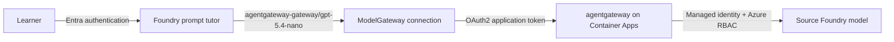
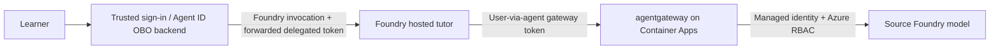

# Microsoft Foundry agents with agentgateway

An azd + Bicep demonstration of **Microsoft Foundry and agentgateway integration
in both directions**: Foundry agents call models through agentgateway, and the
gateway uses managed identity to call a model hosted in Foundry.

Two independent AI tutors demonstrate different integration capabilities:

| Tutor | Foundry integration | Identity at agentgateway |
| --- | --- | --- |
| Prompt agent | Managed ModelGateway connection using OAuth2 client credentials | Dedicated prompt-client application |
| Hosted agent | Python + Microsoft Agent Framework, exposed through Foundry Responses | Human user acting through the hosted Entra Agent ID |

Both target `gpt-5.4-nano` in a separate **source Foundry account**. The
**consumer Foundry account** hosts both tutors without local model capacity.
Neither tutor invokes the other or bypasses the gateway.

**Inference is Entra-only.** There is no shared gateway API key, API-key
connection, or hosted app-only authentication mode. The prompt OAuth client
secret remains necessary for the managed ModelGateway connection; it is not a
shared inference key.

> **Validation:** the identity-only gateway and hosted runtime are tested locally,
> including streaming and denial cases. The previous deployment used hosted
> app-only authentication. Genuine Agent ID user-via-agent inference was verified
> separately, but this repository does not deploy the trusted sign-in/OBO backend.
> Do not treat ordinary playground access as a working delegated caller.

## Architecture

### Prompt tutor: Foundry-managed model access



Foundry obtains an application token for the gateway API using the dedicated
prompt client's credentials. The `/entra/v1/chat/completions` route requires
that application's service principal (`oid`), client ID (`azp`), and app-only
token type. It rejects delegated users and the hosted agent's app-only identity.
The prompt caller's human identity is **not** propagated to agentgateway.

### Hosted tutor: user-via-agent model access



The `/delegated/v1/chat/completions` route validates the signature, tenant,
audience, authorized human (`oid`), hosted Agent ID actor (`azp`), and
`gateway.invoke` scope. App-only tokens cannot use it. The sample authorizes the
deploying human; adapt that explicit policy for your application.

The gateway's managed identity, not the incoming token, authenticates upstream
to the source model. Both Foundry accounts disable local API-key authentication.

## Requirements

### Tooling and capacity

- Azure CLI 2.73+, Azure Developer CLI 1.35+, and Bicep 0.36.1+.
- Foundry agents azd extension 1.0.0-beta.18+.
- Bash and Node.js 20+ for deployment hooks and tests.
- Python 3.13 for local hosted development; remote builds do not require it.
- Subscription quota for `gpt-5.4-nano`, version `2026-03-17`, `GlobalStandard`.
- East US (`eastus`, default), UK South (`uksouth`), or Sweden Central
  (`swedencentral`), subject to service availability and quota.

### Permissions and delegated caller

- **Azure provisioning:** permission to provision resources and assign roles:
  Owner, or Contributor plus an appropriate Azure RBAC administrator role.
- **Entra provisioning:** permission to manage applications, service principals,
  and credentials, such as Application Administrator, Cloud Application
  Administrator, or equivalent permissions.
- **Hosted caller:** a trusted backend performing the
  [Agent ID OBO exchange](https://learn.microsoft.com/en-us/entra/agent-id/agent-on-behalf-of-oauth-flow).
  Configure the hosted blueprint's user-facing API, delegated gateway permission,
  consent, and permission inheritance. Use a federated credential or certificate
  for that backend. These are external prerequisites, not deployed by this sample.
- The trusted backend needs Foundry invocation access and the
  `Microsoft.CognitiveServices/accounts/AIServices/agents/endpoints/UserIdentityImpersonation/action`
  data action when representing the user.

Entra directory permissions do not replace Azure RBAC. Contributor alone cannot
create role assignments. Scripts assume a signed-in human; CI service-principal
deployment is not configured.

## Deploy

Fresh deployments have an explicit bootstrap stage: the vault must exist before
the prompt OAuth credential can be stored. No temporary API-key deployment is
needed.

### 1. Bootstrap shared resources

```bash
az login
azd auth login
azd extension install azure.ai.agents
azd env new agentgateway-demo --location uksouth --subscription <subscription-id>
azd env set AZURE_PRINCIPAL_ID "$(az ad signed-in-user show --query id -o tsv)"

environment="$(azd env get-value AZURE_ENV_NAME)"
location="$(azd env get-value AZURE_LOCATION)"
principal="$(azd env get-value AZURE_PRINCIPAL_ID)"

az deployment sub create --name "$environment-bootstrap" --location "$location" \
  --template-file infra/bootstrap.bicep \
  --parameters environmentName="$environment" location="$location" principalId="$principal" \
  'tags={"CostControl":"Ignore","SecurityControl":"Ignore"}' --output none

azd env set AZURE_RESOURCE_GROUP "$(az deployment sub show \
  --name "$environment-bootstrap" --query properties.outputs.resourceGroupName.value -o tsv)"
azd env set AZURE_KEY_VAULT_NAME "$(az deployment sub show \
  --name "$environment-bootstrap" --query properties.outputs.keyVaultName.value -o tsv)"
```

[bootstrap.bicep](infra/bootstrap.bicep) reuses the same names and modules as the
full deployment for the resource group, gateway identity, monitoring, vault,
and deployer access. It does not create an inference endpoint.
Allow RBAC propagation before storing credentials.

The demo tags in [main.parameters.json](infra/main.parameters.json) are not a
guarantee of governance-policy exemption; use them only where authorized.

### 2. Configure both Entra registrations and the prompt credential

```bash
node scripts/configure-gateway-entra.mjs
node scripts/configure-prompt-gateway-entra.mjs
```

[entra.bicep](infra/entra.bicep) uses a pinned Microsoft Graph extension to
provision both applications/service principals, the gateway scope, token claims,
and CLI preauthorization. Existing registrations retain their IDs, scopes, and
API settings; the adoption helper assigns an immutable `uniqueName` once.
Directory provisioning is separate from ordinary `azd provision`.

Graph Bicep does not manage passwords. The
[credential helper](scripts/configure-prompt-gateway-entra.mjs) creates/reuses a
one-year prompt-client secret in Key Vault. Disabled, expired, or mismatched
credentials require explicit rotation rather than silent replacement.

### 3. Provision and deploy

```bash
vault="$(azd env get-value AZURE_KEY_VAULT_NAME)"
PROMPT_GATEWAY_CLIENT_SECRET="$(az keyvault secret show --vault-name "$vault" \
  --name agentgateway-prompt-client-secret --query value -o tsv)" azd up
```

Supply the credential through the command's process environment, not
`azd env set`. Foundry keeps its own secure connection copy. Rotate the Entra
credential before expiry and update both copies.

The [main template](infra/main.bicep) requires both applications and the prompt
credential. It provisions the source model, consumer projects, identity-only
gateway, and OAuth2 connection. The source model defaults to capacity `10`
(10,000 tokens/minute); set `MODEL_CAPACITY` before provisioning to adjust it.
**GlobalStandard does not guarantee inference residency in the chosen region.**

Native azd code deployment remotely builds the hosted agent without local
Docker or a project-owned registry. Its postdeploy hook grants the hosted
identity telemetry publishing and binds that identity as the gateway's delegated
actor. Until the actor exists, delegated inference is denied.
Project hooks deploy the prompt tutor idempotently.

Configure and test the trusted OBO caller after the hosted Agent ID exists.
There is no fallback to app-only tokens or shared keys.

## Use and update the tutors

### Prompt tutor

The prompt model is `agentgateway-gateway/gpt-5.4-nano`. Edit
[agent.json](agents/ai-tutor-prompt-agent/agent.json), then run:

```bash
azd hooks run postdeploy
```

The [deployment helper](scripts/deploy-prompt-agent.mjs) preserves the
connection-qualified model reference and verifies the persisted version.
Unchanged definitions reuse the latest version.

The prompt connection uses OAuth2 client credentials, **not** the prompt Agent
ID or invoking human. Direct managed-identity authentication was tested and
rejected by Foundry's custom ModelGateway API, which accepts `ApiKey` or `OAuth2`;
this sample uses only OAuth2.

### Hosted tutor

[main.py](agents/ai-tutor-hosted-agent/main.py) adapts Foundry Responses requests
to gateway Chat Completions using the unqualified alias `gpt-5.4-nano`.
Responses-only `include` projections are logged and ignored instead of passed
to Chat Completions. Edit its instructions in
[agent.json](agents/ai-tutor-hosted-agent/agent.json), then run:

```bash
azd deploy ai-tutor-hosted-agent
```

Invoke through the trusted backend using
[Foundry's delegated-token forwarding](https://learn.microsoft.com/en-us/azure/foundry/agents/how-to/use-on-behalf-of-flow):

```http
Authorization: Bearer <Foundry access token>
x-client-agentgateway-access-token: <user-via-agent gateway access token>
x-ms-user-identity: <authenticated human object ID>
Content-Type: application/json

{"input":"Explain fractions.","store":false,"background":false,"stream":false}
```

The forwarded token must target the gateway API, not Foundry or Microsoft Graph.
The runtime isolates it per request, strips the forwarding header before adapter
metadata processing, and rejects stored/background requests. Streaming is
supported. Missing or denied credentials never cause a different identity to be
used. `DefaultAzureCredential` is used only for telemetry, not model inference.
The OpenAI SDK parameter named `api_key` carries the delegated bearer token; it
does not enable shared-key authentication.

### Local development

```bash
python3.13 -m venv agents/ai-tutor-hosted-agent/.venv
agents/ai-tutor-hosted-agent/.venv/bin/python -m pip install \
  -r agents/ai-tutor-hosted-agent/requirements.txt
azd ai agent run ai-tutor-hosted-agent --no-client
```

The selected environment supplies the delegated gateway endpoint. F5 in VS Code
starts the debugger and Agent Inspector with ports 5679/8088. The server can
start without a delegated token, but **every inference request must supply one**.
A plain playground/Inspector/azd chat request without the forwarding header is
rejected; use a caller capable of sending the required headers and stateless
request body.

## Existing-environment migration

This is a breaking change for API-key clients and hosted app-only callers.
Before changing a running deployment, prepare the trusted OBO caller.

1. Reuse the existing gateway/prompt registrations with
   `configure-gateway-entra.mjs`, and run the prompt credential helper. Existing
   deployments do not need the fresh-install bootstrap.
2. Reprovision with only `PROMPT_GATEWAY_CLIENT_SECRET` as shown above. This
   replaces the gateway routes and prompt connection. The hosted app-only
   version will no longer infer; schedule the transition accordingly.
3. Deploy the hosted agent, then verify prompt OAuth and hosted delegated
   inference using the trusted backend.
4. Preview and apply removal of the obsolete key and its readers:

   ```bash
   node scripts/remove-legacy-gateway-key.mjs
   node scripts/remove-legacy-gateway-key.mjs --apply
   ```

The [cleanup helper](scripts/remove-legacy-gateway-key.mjs) refuses cleanup until
the prompt connection uses OAuth2, the latest hosted version is active and
delegated-only, active gateway revisions no longer reference the key, and the
old `/v1/chat/completions` endpoint returns 404. It removes any remaining
Container Apps secret named `agentgateway-api-key`, exact-secret-scoped
**Key Vault Secrets User** assignments, and the Key Vault secret of that name.
It does not delete the prompt-client secret, inherited permissions, the vault,
or telemetry permissions. Key Vault deletion is soft deletion, never purge.
Incomplete metadata or resources remaining after deletion cause an explicit failure.

Incremental Bicep alone does **not** remove previously created secrets or roles.
The cleanup is explicit, not an automatic deployment hook.
Remove obsolete `AGENTGATEWAY_AUTH_MODE`, `HOSTED_GATEWAY_AUTH_MODE`,
`AGENTGATEWAY_TOKEN_SCOPE`, and any old API-key values from local azd/shell/CI
configuration. They no longer select supported modes.

## Permissions and shared monitoring

The deploying human receives resource-group Contributor, vault Secrets Officer,
Foundry User on both accounts, and Log Analytics Reader/Privileged Monitoring
Data Reader on Application Insights and its workspace.

The gateway identity receives **Cognitive Services OpenAI User** on the source
account and **Monitoring Metrics Publisher** on Application Insights. Neither
it nor the hosted agent receives Key Vault secret-read access.
The vault is retained only to manage the prompt OAuth credential.

[monitoring.bicep](infra/modules/monitoring.bicep) provisions shared
workspace-backed Application Insights and Log Analytics with local-auth
ingestion disabled. Both projects connect through **ProjectManagedIdentity**;
their identities receive **Monitoring Metrics Publisher** for ingestion and
**Monitoring Reader** for Foundry Insights, scoped to the component.
The connection uses API `2026-09-01`; published Bicep schemas lag some supported
service properties.

agentgateway sends spans to a loopback-only collector sidecar, which authenticates
using the gateway identity. The hosted tutor exports telemetry using its own
identity with sensitive-message capture disabled. Resource diagnostics from
Foundry, Key Vault, and Container Apps target the shared workspace.

Inspect Application Insights logs, Foundry agent traces, and workspace resource
logs. End-to-end Azure ingestion/correlation and credential rotation still need
validation. Monitoring reader permissions can expose sensitive GenAI data.

## Validate and clean up

```bash
node --test tests/infra.test.mjs tests/agent.test.mjs tests/deployment.test.mjs \
  tests/entra.test.mjs tests/migration.test.mjs tests/gateway.test.mjs
agents/ai-tutor-hosted-agent/.venv/bin/python -m unittest discover \
  -s agents/ai-tutor-hosted-agent -p 'test_*.py'
```

Local tests do not provision Azure or invoke real models. Infrastructure tests
require Azure CLI/Bicep. Gateway tests run the pinned Linux amd64 image against
mock identity/model/OTLP services using Podman with host networking; Docker on
Linux can be selected with `CONTAINER_RUNTIME=docker`.

This is a public-network integration demonstration, not a production landing
zone. The gateway is pinned to `v1.6.0` by digest and runs one always-on replica
(1 vCPU/2 GiB); the collector is `0.162.0` (0.25 vCPU/0.5 GiB). There is no high
availability or persistent spend database. Dependencies include preview
components. Inference, hosting, and monitoring incur charges.

Use `azd down` to remove Azure resources. Entra applications live outside the
resource group; delete the dedicated applications separately when no longer
needed. Vault purge protection and Foundry soft deletion can reserve names;
do not purge automatically. Log retention is 30 days.

## Current azd prompt deployment limitation

Foundry gateway-connected prompt agents require
`<connection-name>/<model-name>`. Native prompt deployment encountered extension
validation rejecting `/`, so this sample uses lifecycle hooks and the Foundry
API while preserving that model reference. Hosted deployment remains native
azd code deployment. The extension's current validation behavior has not been
re-tested here.
