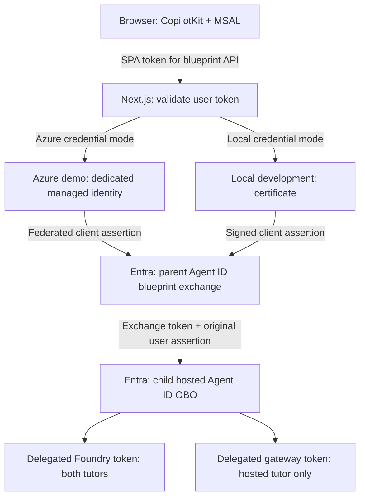
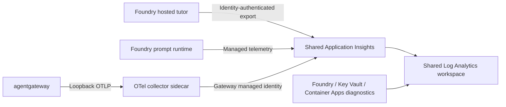

<div align="center">

# Microsoft Foundry agents with agentgateway

**Foundry agents call models through agentgateway, and the gateway calls a model hosted in Foundry with its managed identity. Entra only, no shared key.**

[](infra)
[](azure.yaml)
[](agentgateway)

[**Quick start**](#quick-start) · [**Architecture**](#architecture) · [**Use the tutors**](#use-and-update-the-tutors) · [**Validation**](docs/validation.md) · [**Documentation**](#documentation)

</div>

An azd + Bicep demonstration of **Microsoft Foundry and agentgateway integration
in both directions**: Foundry agents call models through agentgateway, and the
gateway uses managed identity to call a model hosted in Foundry.

Two independent AI tutors demonstrate different integration capabilities:

| Tutor | Foundry integration | Identity at agentgateway |
| --- | --- | --- |
| Prompt agent | Managed ModelGateway connection using OAuth2 client credentials | Dedicated prompt-client application |
| Hosted agent | Python + Microsoft Agent Framework, exposed through Foundry Responses | Human user acting through the hosted Entra Agent ID |

Both target `gpt-5.4-nano` in a separate **source Foundry account**. The
**consumer Foundry account** hosts both tutors without local model capacity.
Neither tutor invokes the other or bypasses the gateway.

**Inference is Entra-only.** There is no shared gateway API key, API-key
connection, or hosted app-only authentication mode. The prompt OAuth client
secret remains necessary for the managed ModelGateway connection; it is not a
shared inference key.

**Live validation completed on 18 October 2026:** both tutors work through the
CopilotKit demo, including Azure-hosted managed-identity federation, delegated
Agent ID OBO, token renewal, and streaming Stop/recovery. The legacy shared key
and its secret-scoped reader assignment have been removed from the tested
environment. See [validation status](docs/validation.md) for evidence and limits.

## Why this sample

An AI gateway such as agentgateway gives every model call one place for authentication, routing and telemetry. This
sample connects it to Microsoft Foundry in both directions, with Entra ID only: the prompt agent reaches the gateway
through a ModelGateway connection with its own client application, the hosted agent calls it as the signed-in user
through its Entra Agent ID, and the gateway reaches the Foundry model with its managed identity.

## Architecture

### Prompt tutor: Foundry-managed model access

```mermaid
flowchart LR
    User["Learner + browser SPA"]
    Backend["Next.js demo backend"]
    Tutor["Foundry prompt tutor"]
    Connection["ModelGateway connection"]
    Gateway["agentgateway on Container Apps"]
    Model["Source Foundry model"]
    User -->|"User token for blueprint API"| Backend
    Backend -->|"Agent ID OBO: delegated Foundry token"| Tutor
    Tutor -->|"agentgateway-gateway/gpt-5.4-nano"| Connection
    Connection -->|"OAuth2 application token"| Gateway
    Gateway -->|"Managed identity + Azure RBAC"| Model
```



Foundry obtains an application token for the gateway API using the dedicated
prompt client's credentials. The `/entra/v1/chat/completions` route requires
that application's service principal (`oid`), client ID (`azp`), and app-only
token type. It rejects delegated users and the hosted agent's app-only identity.
The prompt caller's human identity is **not** propagated to agentgateway.
The demo authenticates the user and performs Agent ID OBO to invoke Foundry,
but the managed connection independently obtains the prompt application's token.

### Hosted tutor: user-via-agent model access

```mermaid
flowchart LR
    User["Learner + browser SPA"]
    Backend["Next.js demo backend"]
    Hosted["Foundry hosted tutor"]
    Gateway["agentgateway on Container Apps"]
    Model["Source Foundry model"]
    User -->|"User token for blueprint API"| Backend
    Backend -->|"Delegated Foundry bearer + forwarded gateway token"| Hosted
    Hosted -->|"User-via-agent gateway token"| Gateway
    Gateway -->|"Managed identity + Azure RBAC"| Model
```



The `/delegated/v1/chat/completions` route validates the signature, tenant,
audience, authorized human (`oid`), hosted Agent ID actor (`azp`), and
`gateway.invoke` scope. App-only tokens cannot use it. The sample authorizes the
deploying human; adapt that explicit policy for your application.

The gateway's managed identity, not the incoming token, authenticates upstream
to the source model. Both Foundry accounts disable local API-key authentication.

### Demo authentication: same OBO flow, different backend credentials



| Boundary | Identity / credential | Purpose |
| --- | --- | --- |
| Browser → demo | Signed-in human; SPA token for the blueprint API | Authenticate the configured demo user |
| Azure demo → blueprint | Dedicated demo managed identity, trusted by a blueprint federated credential | Bootstrap the exchange without a certificate or client secret |
| Local demo → blueprint | Local RSA certificate assertion | Development-only alternative; not deployed to Azure |
| Demo → Foundry | Human user via hosted Agent ID | Invoke either named tutor endpoint |
| Hosted tutor → gateway | Human `oid`, hosted Agent ID `azp`, `gateway.invoke` | Use the delegated gateway route |
| Prompt connection → gateway | Dedicated prompt application | Use the app-only OAuth2 gateway route |
| Gateway → source model | Separate gateway managed identity | Authenticate upstream with Azure RBAC |

The **demo identity**, **hosted Agent ID**, **prompt application**, and **gateway
identity** are distinct. Managed identity replaces the demo backend's blueprint
credential; it does not replace the human or turn OBO into app-only inference.

## What runs where

| Path | What it is |
|---|---|
| [agents/](agents) | The two tutors: `ai-tutor-prompt-agent` (its definition) and `ai-tutor-hosted-agent` (Python, Microsoft Agent Framework) |
| [agentgateway/](agentgateway) | The gateway's configuration and its Entra settings |
| [apps/demo/](apps/demo) | The CopilotKit demo, run locally or hosted on Azure |
| [infra/](infra) | Bicep: the bootstrap, the Foundry accounts, the gateway, the Entra registrations, the demo's hosting |
| [scripts/](scripts) | Configuration and deployment scripts (Entra, the prompt agent, the demo, the evaluation assets) |
| [evaluations/](evaluations) | The tutors' curated cases and rubric |
| [monitoring/](monitoring) | The OpenTelemetry collector's configuration |
| [tests/](tests) | Tests of the infrastructure, the scripts, the demo and the gateway |

## Quick start

### 1. Prerequisites

#### Tooling and capacity

- Azure CLI 2.73+, Azure Developer CLI 1.35+, and Bicep 0.36.1+.
- Foundry agents azd extension 1.0.0-beta.18+.
- Bash and Node.js 20+ for deployment hooks and tests.
- Node.js 22+ and npm for the optional local CopilotKit demo.
- Python 3.13 for local hosted development; remote builds do not require it.
- Subscription quota for `gpt-5.4-nano`, version `2026-03-17`, `GlobalStandard`.
- East US (`eastus`, default), UK South (`uksouth`), or Sweden Central
  (`swedencentral`), subject to service availability and quota.

#### Permissions and delegated caller

- **Azure provisioning:** permission to provision resources and assign roles:
  Owner, or Contributor plus an appropriate Azure RBAC administrator role.
- **Entra provisioning:** permission to manage applications, service principals,
  and credentials, such as Application Administrator, Cloud Application
  Administrator, or equivalent permissions.
- **Hosted caller:** a trusted backend performing the
  [Agent ID OBO exchange](https://learn.microsoft.com/en-us/entra/agent-id/agent-on-behalf-of-oauth-flow).
  Configure the hosted blueprint's user-facing API, delegated gateway permission,
  consent, and permission inheritance. Use a federated credential or certificate
  for that backend. The optional demo setup below configures these explicitly.
- The demo calls Foundry with a **delegated user-via-agent Foundry token**; the
  authorized human already receives Foundry User during provisioning. This is
  separate from the gateway-scoped delegated token forwarded to the hosted tutor.
  It deliberately does not fall back to workload authentication.
- If you instead implement Foundry's separate workload-authenticated invocation
  pattern with `x-ms-user-identity`, that workload needs invocation access and the
  `Microsoft.CognitiveServices/accounts/AIServices/agents/endpoints/UserIdentityImpersonation/action`
  data action when representing the user. The demo does not select that pattern.

Entra directory permissions do not replace Azure RBAC. Contributor alone cannot
create role assignments. Scripts assume a signed-in human; CI service-principal
deployment is not configured.

Fresh deployments have an explicit bootstrap stage: the vault must exist before
the prompt OAuth credential can be stored. No temporary API-key deployment is
needed.

### 2. Bootstrap shared resources

```bash
az login
azd auth login
azd extension install azure.ai.agents
azd env new agentgateway-demo --location uksouth --subscription <subscription-id>
azd env set AZURE_PRINCIPAL_ID "$(az ad signed-in-user show --query id -o tsv)"

environment="$(azd env get-value AZURE_ENV_NAME)"
location="$(azd env get-value AZURE_LOCATION)"
principal="$(azd env get-value AZURE_PRINCIPAL_ID)"

az deployment sub create --name "$environment-bootstrap" --location "$location" \
  --template-file infra/bootstrap.bicep \
  --parameters environmentName="$environment" location="$location" principalId="$principal" \
  'tags={"CostControl":"Ignore","SecurityControl":"Ignore"}' --output none

azd env set AZURE_RESOURCE_GROUP "$(az deployment sub show \
  --name "$environment-bootstrap" --query properties.outputs.resourceGroupName.value -o tsv)"
azd env set AZURE_KEY_VAULT_NAME "$(az deployment sub show \
  --name "$environment-bootstrap" --query properties.outputs.keyVaultName.value -o tsv)"
```

[bootstrap.bicep](infra/bootstrap.bicep) reuses the same names and modules as the
full deployment for the resource group, gateway identity, monitoring, vault,
and deployer access. It does not create an inference endpoint.
Allow RBAC propagation before storing credentials.

The demo tags in [main.parameters.json](infra/main.parameters.json) are not a
guarantee of governance-policy exemption; use them only where authorized.

### 3. Configure both Entra registrations and the prompt credential

```bash
node scripts/configure-gateway-entra.mjs
node scripts/configure-prompt-gateway-entra.mjs
```

[entra.bicep](infra/entra.bicep) uses a pinned Microsoft Graph extension to
provision both applications/service principals, the gateway scope, token claims,
and CLI preauthorization. Existing registrations retain their IDs, scopes, and
API settings; the adoption helper assigns an immutable `uniqueName` once.
Directory provisioning is separate from ordinary `azd provision`.

Graph Bicep does not manage passwords. The
[credential helper](scripts/configure-prompt-gateway-entra.mjs) creates/reuses a
one-year prompt-client secret in Key Vault. Disabled, expired, or mismatched
credentials require explicit rotation rather than silent replacement.

### 4. Provision and deploy

```bash
vault="$(azd env get-value AZURE_KEY_VAULT_NAME)"
PROMPT_GATEWAY_CLIENT_SECRET="$(az keyvault secret show --vault-name "$vault" \
  --name agentgateway-prompt-client-secret --query value -o tsv)" azd up
```

Supply the credential through the command's process environment, not
`azd env set`. Foundry keeps its own secure connection copy. Rotate the Entra
credential before expiry and update both copies.

The [main template](infra/main.bicep) requires both applications and the prompt
credential. It provisions the source model, consumer projects, identity-only
gateway, and OAuth2 connection. The source model defaults to capacity `10`
(10,000 tokens/minute); set `MODEL_CAPACITY` before provisioning to adjust it.
**GlobalStandard does not guarantee inference residency in the chosen region.**

Native azd code deployment remotely builds the hosted agent without local
Docker or a project-owned registry. Its postdeploy hook grants the hosted
identity telemetry publishing and binds that identity as the gateway's delegated
actor. Until the actor exists, delegated inference is denied.
Project hooks deploy the prompt tutor idempotently.

Configure and test the trusted OBO caller after the hosted Agent ID exists.
There is no fallback to app-only tokens or shared keys.

### 5. Run the demo

Run the CopilotKit demo [on your machine](docs/local-demo.md), or [hosted on Azure with managed identity
federation](docs/hosted-demo.md).

## Use and update the tutors

### Prompt tutor

The prompt model is `agentgateway-gateway/gpt-5.4-nano`. Edit
[agent.json](agents/ai-tutor-prompt-agent/agent.json), then run:

```bash
azd hooks run postdeploy
```

The [deployment helper](scripts/deploy-prompt-agent.mjs) preserves the
connection-qualified model reference and verifies the persisted version.
Unchanged definitions reuse the latest version.

The prompt connection uses OAuth2 client credentials, **not** the prompt Agent
ID or invoking human. Direct managed-identity authentication was tested and
rejected by Foundry's custom ModelGateway API, which accepts `ApiKey` or `OAuth2`;
this sample uses only OAuth2.

### Hosted tutor

[main.py](agents/ai-tutor-hosted-agent/main.py) adapts Foundry Responses requests
to gateway Chat Completions using the unqualified alias `gpt-5.4-nano`.
Responses-only `include` projections are logged and ignored instead of passed
to Chat Completions. Edit its instructions in
[agent.json](agents/ai-tutor-hosted-agent/agent.json), then run:

```bash
azd deploy ai-tutor-hosted-agent
```

Invoke through the trusted backend using
[Foundry's delegated-token forwarding](https://learn.microsoft.com/en-us/azure/foundry/agents/how-to/use-on-behalf-of-flow):

```http
Authorization: Bearer <delegated user-via-agent Foundry access token>
x-client-agentgateway-access-token: <user-via-agent gateway access token>
Content-Type: application/json

{"input":"Explain fractions.","store":false,"background":false,"stream":false}
```

The forwarded token must target the gateway API, not Foundry or Microsoft Graph.
The runtime isolates it per request, strips the forwarding header before adapter
metadata processing, and rejects stored/background requests. Streaming is
supported. Missing or denied credentials never cause a different identity to be
used. `DefaultAzureCredential` is used only for telemetry, not model inference.
The OpenAI SDK parameter named `api_key` carries the delegated bearer token; it
does not enable shared-key authentication.

The demo uses the
[named agent Responses endpoints](https://learn.microsoft.com/en-us/azure/foundry/agents/quickstarts/prompt-agent)
for both tutors. It does not send `x-ms-user-identity`: that header belongs to the
separate workload-impersonation pattern described in Foundry's OBO documentation.
Direct delegated Foundry invocation plus gateway-token forwarding is the
combination verified by the live checks in the tested environment.

### Local development

```bash
python3.13 -m venv agents/ai-tutor-hosted-agent/.venv
agents/ai-tutor-hosted-agent/.venv/bin/python -m pip install \
  -r agents/ai-tutor-hosted-agent/requirements.txt
azd ai agent run ai-tutor-hosted-agent --no-client
```

The selected environment supplies the delegated gateway endpoint. F5 in VS Code
starts the debugger and Agent Inspector with ports 5679/8088. The server can
start without a delegated token, but **every inference request must supply one**.
A plain playground/Inspector/azd chat request without the forwarding header is
rejected; use a caller capable of sending the required headers and stateless
request body.

## Permissions and shared monitoring

The deploying human receives resource-group Contributor, vault Secrets Officer,
Foundry User on both accounts, and Log Analytics Reader/Privileged Monitoring
Data Reader on Application Insights and its workspace.

The gateway identity receives **Cognitive Services OpenAI User** on the source
account and **Monitoring Metrics Publisher** on Application Insights. Neither
it nor the hosted agent receives Key Vault secret-read access.
The vault is retained only to manage the prompt OAuth credential.

[monitoring.bicep](infra/modules/monitoring.bicep) provisions shared
workspace-backed Application Insights and Log Analytics with local-auth
ingestion disabled. Both projects connect through **ProjectManagedIdentity**;
their identities receive **Monitoring Metrics Publisher** for ingestion and
**Monitoring Reader** for Foundry Insights, scoped to the component.
The connection uses API `2026-09-01`; published Bicep schemas lag some supported
service properties.

agentgateway sends spans to a loopback-only collector sidecar, which authenticates
using the gateway identity. The hosted tutor exports telemetry using its own
identity with sensitive-message capture disabled. Resource diagnostics from
Foundry, Key Vault, and Container Apps target the shared workspace.



| Observability surface | Verified state / limit |
| --- | --- |
| Shared ingestion | Hosted tutor, prompt runtime, and gateway telemetry observed in Application Insights |
| Distributed correlation | Hosted request, hosted dependencies, gateway request, and upstream span observed with the same `operation_Id` |
| Credential-pattern scan | No JWT-like strings, bearer values, or private keys matched in the sampled two-hour window; not a guarantee about every possible secret form |
| Demo backend | No Next.js Application Insights span export configured; no full browser → demo → Foundry distributed trace is claimed |
| Sensitive data | Hosted sensitive-message capture is disabled; monitoring-reader access can still expose sensitive operational/GenAI data |

Inspect Application Insights logs, Foundry agent traces, and workspace resource
logs. Do not print tokens, private keys, prompts, or model responses when
collecting authentication evidence.

## Documentation

| Document | What it covers |
|---|---|
| [docs/local-demo.md](docs/local-demo.md) | The CopilotKit demo on your machine: certificate, Entra configuration, the two tutors, offline and live acceptance |
| [docs/hosted-demo.md](docs/hosted-demo.md) | The CopilotKit demo hosted on Azure with managed identity federation |
| [docs/migration.md](docs/migration.md) | Upgrading an older API-key deployment |
| [docs/validation.md](docs/validation.md) | What was verified live, what remains, and how to run the tests |
| [docs/evaluations.md](docs/evaluations.md) | The tutors' evaluations: datasets, rubrics, costs, commands |
| [docs/prompt-agent-deployment.md](docs/prompt-agent-deployment.md) | Why the prompt agent is deployed from lifecycle hooks |

## Tech stack

Versions used in October 2026:

| Technology | Role | Version |
|---|---|---|
| [Microsoft Foundry](https://learn.microsoft.com/azure/ai-foundry/) | The prompt and hosted agents, and the source model | `gpt-5.4-nano` |
| [agentgateway](https://agentgateway.dev) on Azure Container Apps | The gateway | v1.6.0 |
| [Microsoft Agent Framework](https://github.com/microsoft/agent-framework) | The hosted tutor (Python) | 1.22 |
| [CopilotKit](https://www.copilotkit.ai), [Next.js](https://nextjs.org), [MSAL](https://github.com/AzureAD/microsoft-authentication-library-for-js) | The demo | 1.79, 16.4, 5.25 |
| [OpenTelemetry Collector](https://opentelemetry.io/docs/collector/) | The gateway's telemetry | 0.162.0 |
| [Bicep](https://learn.microsoft.com/azure/azure-resource-manager/bicep/) and [azd](https://learn.microsoft.com/azure/developer/azure-developer-cli/) | The infrastructure and its deployment | azd 1.35+, `azure.ai.agents` 1.0.0-beta.18 |

## Versions and preview notes

As of October 2026:

- The hosted tutor uses `agent-framework-foundry-hosting` 1.0.0b261015, a pre-release package.
- The azd agents extension is `azure.ai.agents` 1.0.0-beta.18, a pre-release.

## Clean up

Use `azd down` to remove Azure resources. Entra applications live outside the
resource group; delete the dedicated applications separately when no longer
needed. Vault purge protection and Foundry soft deletion can reserve names;
do not purge automatically. Log retention is 30 days.

This is a public-network integration demonstration, not a production landing
zone. The gateway is pinned to `v1.6.0` by digest and runs one always-on replica
(1 vCPU/2 GiB); the collector is `0.162.0` (0.25 vCPU/0.5 GiB). There is no high
availability or persistent spend database. Dependencies include preview
components. Inference, hosting, and monitoring incur charges.
