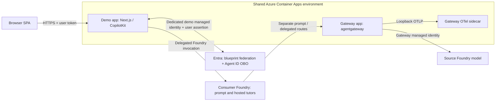

# Azure-hosted CopilotKit demo: managed identity federation

The same Next.js app can run as a **separate Container App in the gateway's
existing ACA environment**, using its own user-assigned managed identity. It
does not reuse the gateway identity or run inside the Foundry hosted tutor.
The managed identity is trusted by a federated identity credential on the
existing hosted Agent ID blueprint.



The Foundry tutors do **not** run in the shared Container Apps environment.
The demo and gateway are separate apps with separate managed identities.

This replaces only the blueprint credential, not delegated user authentication.
The gateway still requires the configured human and hosted Agent ID. There is
no app-only, certificate, or API-key fallback when managed identity fails.
The app uses an explicit `ManagedIdentityCredential` with the dedicated identity's
client ID, not a general developer credential chain.

After completing the existing gateway, hosted tutor, and demo Entra setup:

```bash
# Read-only preview, bound to the selected azd environment:
node scripts/deploy-demo.mjs
# Provision, federate, remotely build, deploy, and check public configuration:
node scripts/deploy-demo.mjs --apply
```

The [deployment helper](../scripts/deploy-demo.mjs) uses
[demo-hosting.bicep](../infra/demo-hosting.bicep) as a separate resource-group
deployment alongside the main azd infrastructure. It creates a dedicated Basic
ACR registry, dedicated identity, registry-scoped AcrPull assignment, and the
Next.js app. These incur additional Azure charges. It does not redeploy the
gateway or Foundry tutors. Rerun this helper after changing the demo; the root
`azd deploy` still deploys the Foundry hosted tutor, not the web app.

ACR builds the image remotely; no local container daemon or registry password
is needed. The [Docker context allowlist](../apps/demo/.dockerignore) excludes local
environment files, certificates, dependencies, and test artifacts. The production
image runs as a non-root user, contains Next.js standalone output, and is deployed
by immutable image digest. The app uses HTTPS ingress, readiness/startup probes,
and scales from zero to one replica. CopilotKit's in-memory runner coordinates
Stop requests within one process; multiple replicas require shared run coordination.
Active runs do not survive a restart or redeployment. Stop aborts the bridge's
Foundry HTTP request, but does not prove that Foundry or the model stops billing.

The helper preserves existing SPA callbacks, including localhost, adds the
hosted HTTPS callback, and preserves existing blueprint keys and unrelated
federated credentials. It refuses to replace an existing demo federation that
trusts a different identity. The federation uses the managed identity's
**principal ID** as subject; runtime selection uses its **client ID**.
Only nonsecret identifiers and `DEMO_HOSTED_ENDPOINT` are saved to azd.
The existing local `DEMO_ORIGIN` and ignored local configuration are not replaced.
No certificate or private-key path is configured in the Azure app.

Open `DEMO_HOSTED_ENDPOINT`, sign in as the configured human, and select
**Run live checks**. This verifies the same delegated flows and gateway denials
as the local demo, now bootstrapped by the Azure managed identity.
Deployment readiness alone does not prove the delegated exchanges.

Credential mode is explicit:

| Mode | Required configuration | Restrictions |
| --- | --- | --- |
| Local certificate | `DEMO_AUTH_MODE=certificate`, certificate and private-key paths | Loopback development origin only |
| Azure managed identity | `DEMO_AUTH_MODE=managed-identity`, `DEMO_MANAGED_IDENTITY_CLIENT_ID` | Rejects certificate/key settings; no credential fallback |

Existing local environment files must add the explicit mode when upgrading.
Managed identity is not available merely by signing in to Azure CLI from an
ordinary local process.

See Microsoft's [Agent ID OBO protocol](https://learn.microsoft.com/entra/agent-id/agent-on-behalf-of-oauth-flow)
and [managed identity federation configuration](https://learn.microsoft.com/entra/workload-id/workload-identity-federation-config-app-trust-managed-identity).
